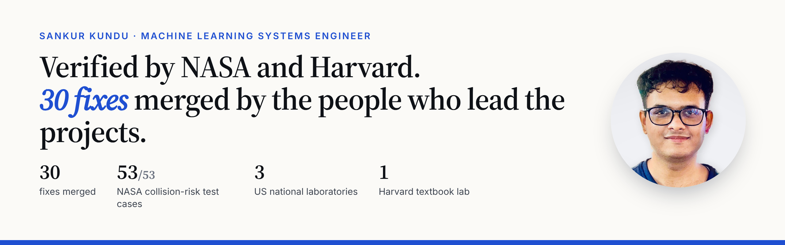

  

  
  
  
  

Machine learning systems engineer. I build graphics processing unit (GPU) software for artificial intelligence (AI) and science, and prove every result against an independent reference.

> *"Your sampling space results indeed appear to be fully consistent with what we see in CARA operations."*
> **NASA's Conjunction Assessment Risk Analysis (CARA) team**, on my reproduction of its collision probabilities ([kessler](https://shakhtar-sankur.github.io/kessler/))

> *"Every result in your table reproduces."*
> **Prof. Vijay Janapa Reddi, Harvard University**, merging my lab into his Machine Learning Systems textbook ([#2175](https://github.com/harvard-edge/cs249r_book/pull/2175))

### 30 fixes merged by the people who lead the projects

| Organisation | What I fixed | Approved or merged by |
|---|---|---|
| **Google** · [XLA #52906](https://github.com/openxla/xla/pull/52906) | Accelerated Linear Algebra compiler (behind JAX) returned 0 instead of 10 | XLA reviewer: *"The change in the PR is correct"* |
| **Idaho National Laboratory** · [MOOSE #34496](https://github.com/idaholab/moose/pull/34496) | A boundary condition's Jacobian had the wrong sign; admittance made complex | Casey Icenhour, who wrote the module |
| **Los Alamos & Oak Ridge National Laboratories** · [Kokkos #9738](https://github.com/kokkos/kokkos/pull/9738) | GPU sort failed to build on NVIDIA and AMD GPUs | Damien Lebrun-Grandié, Kokkos lead |
| **European Space Agency** · [pagmo2 #660](https://github.com/esa/pagmo2/pull/660) | A crash open since May 2024 | Dario Izzo, co-author |
| **ITER** · [IMAS-Python #152](https://github.com/iterorganization/IMAS-Python/pull/152) | Two fixes to the fusion project's data library | Olivier Hoenen |
| **US National Institute of Standards and Technology** · [FiPy #1243](https://github.com/usnistgov/fipy/pull/1243) | Boundary distances truncated on integer grids | Jonathan Guyer, one of its authors |
| **gem5** · [#3762](https://github.com/gem5/gem5/pull/3762) | Read 1.8e-09 as 1.8 − 9 (−61,489.8 instead of 0.285) | Jason Lowe-Power, gem5 lead |

Also merged at the Massachusetts Institute of Technology, the UK Met Office (twice), NVIDIA, Apple, Meta, IBM Quantum, Tencent, the Barcelona Supercomputing Center, Estonia's Information System Authority, the University of Oxford, Carnegie Mellon University, Hugging Face and Contrails.org. [See all 30 →](https://shakhtar-sankur.github.io/#merged)

### Things I built

| Project | Result |
|---|---|
| [**kessler**](https://shakhtar-sankur.github.io/kessler/) | NASA CARA's collision probability on **53 of 53** test cases, 15–19× faster per core |
| [**chirp**](https://github.com/Shakhtar-Sankur/chirp) | Finds **62 of 71** gravitational-wave events of the Laser Interferometer Gravitational-Wave Observatory (LIGO) blind |
| [**syndrome**](https://shakhtar-sankur.github.io/syndrome/) | Decodes IBM's quantum codes bit for bit, **28.7×** faster |
| [**tessel**](https://shakhtar-sankur.github.io/tessel/) | A tile-language compiler in Rust at **parity with NVIDIA cuBLAS** |
| [**samebit**](https://github.com/Shakhtar-Sankur/samebit) | A language model run entirely in integers, **the same bits** on a GPU and a CPU |
| [**Larzavan**](https://github.com/Shakhtar-Sankur/larzavan) | Open earthquake early warning for the whole world: Tohoku's **9.0 read as 8.8** from satellite positioning |

Every claim links to its public record. Open to machine learning systems, GPU and research roles; relocation welcome.
